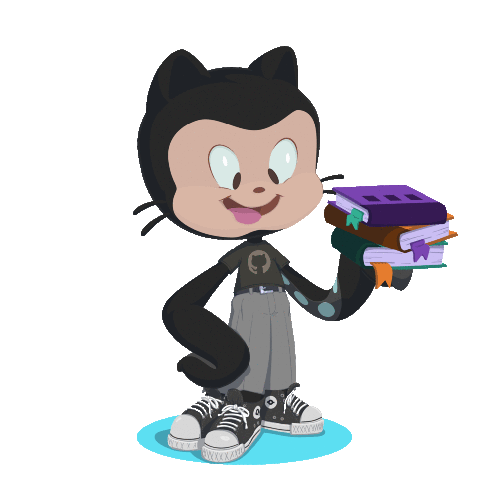

# Hi, I'm Jonathan 👋 

**Software Engineer** | **Mexico 🇲🇽** | **Human (mostly)**

I build clean, scalable applications, collaborate with humans, and politely ask AI to review my variable names so it spares me during the robot uprising. Currently surviving code reviews as a Software Engineer in the **HealthTech & Credentialing** space.

### 👾 The Human Side
- 🌮 Fueled by La Huasteca regional food, culture, and traditions. 
- 🍩 Die-hard fan of The Simpsons (I can and will use a Simpsons quote for any given debugging situation).
- 🎬 MCU fan, movie lover, and heavy listener of Rock, Ska & Metal 🤘🏽.
- ⛰️ Daydreaming about centering `div`s from a cabin in the mountains or a hammock on the beach 🏖️.

---

### 🧰 Tech Stack (Stuff I write & AI debugs)

**Frontend & Design:**  
     

**Backend (I know enough to be dangerous):**  
    

**Data, Tools & AI Whispering:**  
   

🤖 **AI-Adaptive:** Fluent in Claude/Codex whispering, orchestrating Model Context Protocol (MCP) servers, and quickly adapting to whatever LLM is currently trying to do my job.

---

### 🌎 Let's Connect

 

 
